Модель данных MentorLM. Postgres свой, в docker (152-ФЗ, ч.5 ст.18 — ПДн граждан
РФ записываются в базу на территории РФ); дев и прод — две разные базы.
Актуально на 02.10.2026.

## Раздел A. Полная модель (служебные таблицы Django + наши)

```mermaid
erDiagram
    %% ───── Служебные таблицы Django ─────
    auth_user ||--o{ auth_user_groups : ""
    auth_group ||--o{ auth_user_groups : ""
    auth_user ||--o{ auth_user_user_permissions : ""
    auth_permission ||--o{ auth_user_user_permissions : ""
    auth_group ||--o{ auth_group_permissions : ""
    auth_permission ||--o{ auth_group_permissions : ""
    django_content_type ||--o{ auth_permission : ""
    auth_user ||--o{ django_admin_log : ""
    django_content_type ||--o{ django_admin_log : ""

    %% ───── Наши доменные таблицы ─────
    users_userprofile ||--|| users_usersettings : "has (1:1)"
    users_userprofile ||--o{ users_refreshtoken : "sessions"
    users_userprofile ||--o{ users_emailtoken : "mail links"
    users_userprofile ||--o{ conversations_conversation : "owns"
    conversations_conversation ||--o{ conversations_message : "contains"
    conversations_message ||--o{ conversations_attachment : "has"
    users_userprofile ||--o{ usage_usage : "daily rollup"
    users_userprofile ||--o{ usage_usageevent : "ledger"
    users_userprofile ||--o{ memory_usermemoryfact : "remembers"
    users_userprofile |o--o{ billing_subscription : "subscribes (SET_NULL)"
    users_userprofile |o--o{ billing_payment : "pays (SET_NULL)"
    billing_subscription |o--o{ billing_payment : "paid by"
    billing_payment ||--o{ billing_refund : "refunded (PROTECT)"
    users_userprofile |o--o{ billing_billingevent : "consents"
    billing_subscription |o--o{ billing_billingevent : "events"

    auth_user {
        int id PK
        string username
        string email
        bool is_staff
        bool is_superuser
    }
    django_session {
        string session_key PK
        text session_data
        datetime expire_date
    }
    django_migrations {
        int id PK
        string app
        string name
        datetime applied
    }

    users_userprofile {
        bigint id PK
        string email UK
        string password
        bool is_active
        bool email_verified
        datetime consent_accepted_at
        datetime created_at
    }
    users_usersettings {
        bigint id PK
        bigint user_id FK
        string theme
        string chat_model
        string creativity
        bool auto_memory
        text custom_about
        datetime updated_at
    }
    users_refreshtoken {
        bigint id PK
        bigint user_id FK
        string token_hash UK
        datetime expires_at
        datetime revoked_at
    }
    users_emailtoken {
        bigint id PK
        bigint user_id FK
        string purpose
        string token_hash UK
        datetime expires_at
        datetime used_at
    }
    conversations_conversation {
        bigint id PK
        bigint user_id FK
        string mode
        string scenario_id
        string title
        bool pinned
        datetime updated_at
    }
    conversations_message {
        bigint id PK
        bigint conversation_id FK
        string role
        string kind
        text content
        json meta
        string model
        datetime created_at
    }
    conversations_attachment {
        bigint id PK
        bigint message_id FK
        string filename
        int size
        text extracted_text
    }
    usage_usage {
        bigint id PK
        bigint user_id FK
        date day
        string mode
        int request_count
        bigint billable_tokens
    }
    usage_usageevent {
        bigint id PK
        bigint user_id FK
        bigint conversation_id FK
        string mode
        string model
        string plan
        int billable_tokens
        bool degraded
        datetime created_at
    }
    memory_usermemoryfact {
        bigint id PK
        bigint user_id FK
        bigint source_conversation_id FK
        string content
        datetime last_used_at
    }
    billing_subscription {
        bigint id PK
        bigint user_id FK
        string plan
        string status
        bool auto_renew
        string payment_method_id
        datetime current_period_end
    }
    billing_payment {
        bigint id PK
        bigint user_id FK
        bigint subscription_id FK
        string kind
        string status
        decimal amount
        string external_id UK
        uuid idempotence_key UK
    }
    billing_refund {
        bigint id PK
        bigint payment_id FK
        decimal amount
        string status
        string reason
    }
    billing_billingevent {
        bigint id PK
        bigint user_id FK
        bigint subscription_id FK
        string kind
        datetime created_at
    }
    mailer_sentletter {
        bigint id PK
        string to_email
        string letter
        string status
        datetime created_at
    }
```

### Служебные таблицы Django (создаются автоматически)

| Таблица                                                                    | Назначение                                                    |
| -------------------------------------------------------------------------- | ------------------------------------------------------------- |
| `django_migrations`                                                        | Журнал применённых миграций                                   |
| `django_content_type`                                                      | Реестр моделей (для прав и админки)                           |
| `django_session`                                                           | Серверные сессии — только для входа в `/admin/`               |
| `django_admin_log`                                                         | История действий в админ-панели                               |
| `auth_user`                                                                | Пользователи **Django-админки** (НЕ пользователи приложения!) |
| `auth_group`, `auth_permission`                                            | Группы и права доступа                                        |
| `auth_user_groups`, `auth_user_user_permissions`, `auth_group_permissions` | M2M-связки прав                                               |

> `auth_user` — это про вход в `/admin`, а не про пользователей продукта.
> Пользователь MentorLM = `users_userprofile`, логин — email. Два контура
> разделены намеренно: учётка админа не должна быть учёткой продукта.

## Раздел B. Наши таблицы

```mermaid
erDiagram
    UserProfile ||--|| UserSettings : "has (1:1)"
    UserProfile ||--o{ RefreshToken : "sessions"
    UserProfile ||--o{ EmailToken : "mail links"
    UserProfile ||--o{ Conversation : "owns"
    Conversation ||--o{ Message : "contains"
    Message ||--o{ Attachment : "has"
    UserProfile ||--o{ Usage : "daily rollup"
    UserProfile ||--o{ UsageEvent : "ledger"
    Conversation |o--o{ UsageEvent : "SET_NULL"
    UserProfile ||--o{ UserMemoryFact : "remembers"
    UserProfile |o--o{ Subscription : "SET_NULL"
    UserProfile |o--o{ Payment : "SET_NULL"
    Subscription |o--o{ Payment : "SET_NULL"
    Payment ||--o{ Refund : "PROTECT"
    UserProfile |o--o{ BillingEvent : "SET_NULL"
    Subscription |o--o{ BillingEvent : "SET_NULL"

    UserProfile {
        bigint id PK
        string email UK "логин, в нижнем регистре"
        string password "хэш Django (PBKDF2)"
        bool is_active "блок без удаления"
        bool email_verified "гейт оплаты"
        datetime last_login_at
        datetime consent_accepted_at "152-ФЗ"
        string consent_policy_version
        ip consent_ip
    }
    UserSettings {
        bigint user_id FK "1:1"
        string theme "вид"
        string chat_model "тиры моделей по режимам"
        string creativity "мягкие сдвиги над сценарием"
        text custom_about "персона, с лимитом длины"
        string memory_use "память"
    }
    RefreshToken {
        bigint user_id FK
        string token_hash UK "sha256"
        datetime expires_at "30 дней"
        datetime revoked_at
    }
    EmailToken {
        bigint user_id FK
        string purpose "verify_email | password_reset"
        string token_hash UK "sha256"
        string email "куда ушло письмо"
        datetime used_at "одноразовый"
    }
    Conversation {
        bigint user_id FK
        string mode "chat | code | research"
        string scenario_id "сценарий диалога"
        string title
        bool pinned
    }
    Message {
        bigint conversation_id FK
        string role "user | assistant"
        string kind "text | notice"
        text content
        json meta "плашки, источники"
        string model "кто ответил"
    }
    Attachment {
        bigint message_id FK
        string filename
        int size
        text extracted_text "сам файл не храним"
    }
    Usage {
        bigint user_id FK
        date day
        string mode "uniq: (user, day, mode)"
        int request_count
        bigint billable_tokens "µ$"
    }
    UsageEvent {
        bigint user_id FK
        bigint conversation_id FK "SET_NULL"
        string mode
        string model
        string plan "чья квота"
        int cache_read_tokens "из tokens_in"
        int billable_tokens "µ$"
        bool degraded
        bool thinking
    }
    UserMemoryFact {
        bigint user_id FK
        bigint source_conversation_id FK "SET_NULL"
        string content "≤300 симв."
        datetime last_used_at
    }
    Subscription {
        bigint user_id FK "SET_NULL"
        string plan "free | trial | plus | pro"
        string status "pending|active|past_due|canceled"
        bool auto_renew "можем списать"
        bool auto_renew_requested "человек просил"
        string payment_method_id
        datetime renewal_notified_at "без него списывать нельзя"
    }
    Payment {
        bigint user_id FK "SET_NULL"
        string user_email "снимок"
        string kind "initial|renewal|upgrade"
        string status
        decimal amount
        string external_id UK "id в ЮKassa"
        uuid idempotence_key UK
        string npd_receipt_url "чек «Мой налог»"
    }
    Refund {
        bigint payment_id FK "PROTECT"
        decimal amount
        string reason "основание по оферте"
    }
    BillingEvent {
        bigint user_id FK "SET_NULL"
        string kind "согласия и списания"
        ip ip
    }
    SentLetter {
        string to_email "снимок, не FK"
        string letter
        string status "sent | failed"
        text error
    }
```

---

### 1) `UserProfile` — `apps/users/models.py`

Учётная запись пользователя продукта. Своя, а не внешнего провайдера (Clerk убран —
152-ФЗ). Поля `plan` **нет**: тариф считается из подписок (`billing.plans.effective_plan`).

| Поле                     | Тип                               | Описание |
| ------------------------ | --------------------------------- | -------- |
| `id`                     | BigAuto PK                        | — |
| `email`                  | EmailField, **unique, index**     | Логин; нормализуется (без пробелов, нижний регистр) |
| `password`               | CharField(128)                    | Хэш Django, не пароль |
| `is_active`              | Bool, default `True`              | Блокировка без удаления |
| `email_verified`         | Bool, default `False`             | Подтверждён ли адрес. Гейт **только оплаты** (`EmailVerified`) |
| `last_login_at`          | DateTime, null                    | — |
| `consent_accepted_at`    | DateTime, null                    | Момент согласия на обработку ПДн |
| `consent_policy_version` | CharField(20), blank              | Редакция политики (`PRIVACY_POLICY_VERSION`) |
| `consent_ip`             | GenericIP, null                   | Адрес, с которого дано согласие |
| `created_at` / `updated_at` | DateTime                       | — |

`is_authenticated = True` / `is_anonymous = False` — чтобы DRF `IsAuthenticated`
пропускал не-Django пользователя. Удаление профиля (`DELETE /api/me/`) каскадом
стирает настройки, токены, диалоги, память, расход; платёжные записи остаются
(`SET_NULL`).

### 2) `UserSettings` — `apps/users/models.py`

Продуктовые и ИИ-настройки, 1:1 с `UserProfile` (`related_name="settings"`).
Варианты, дефолты и лимиты длины — из `apps/ai/preferences.py`. Параметры модели —
**мягкие сдвиги поверх сценария**, реальные значения собирает `resolve_preferences`.

| Группа              | Поле                          | Тип / дефолт                              | Описание |
| ------------------- | ----------------------------- | ----------------------------------------- | -------- |
| —                   | `user`                        | OneToOne → `UserProfile` (CASCADE)        | — |
| Вид                 | `theme`                       | `system`/`light`/`dark`, default `system` | Тема |
|                     | `font_size`                   | `sm`/`md`/`lg`, default `md`              | Размер шрифта |
| Данные              | `chat_retention_days`         | 0/30/90/180, default **30**               | Автоудаление чатов; 0 — не удалять |
| Модель ИИ           | `chat_model` / `code_model` / `research_model` | `default`/`fast`/`quality`, default `default` | Тир модели по режимам; недоступный тарифу зажимается |
|                     | `creativity`                  | `precise`/`balanced`/`creative`           | Сдвиг температуры ∓0.15 |
|                     | `response_length_preference`  | `shorter`/`default`/`longer`              | Сдвиг длины ±1 |
|                     | `reasoning_depth`             | `fast`/`auto`/`deep`                      | Сдвиг усилия ±1 (по умолчанию; переключатель в композере перекрывает) |
| Память и инструкции | `nickname`                    | CharField(**50**), blank                  | Как обращаться |
|                     | `occupation`                  | CharField(**100**), blank                 | Род занятий |
|                     | `education_level`             | choices (school…postgraduate/other), blank | Уровень обучения |
|                     | `field_of_study`              | CharField(**120**), blank                 | Направление |
|                     | `learning_goals`              | TextField(max **600**), blank             | Цели |
|                     | `custom_about`                | TextField(max **1500**), blank            | «О себе» |
|                     | `custom_style`                | TextField(max **1000**), blank            | Стиль ответов |
|                     | `context_depth`               | `compact`/`normal`/`deep`/`maximum`       | Множитель предыстории |
|                     | `auto_memory`                 | Bool, default `True`                      | Извлекать факты |
|                     | `memory_scope`                | `minimal`/`balanced`/`detailed`           | Что запоминать |
|                     | `memory_use`                  | `off`/`auto`/`always`, default `auto`     | Подмешивать ли факты (0/8/12) |
| —                   | `updated_at`                  | DateTime auto                             | — |

> Дефолты дублируются во фронтовом `DEFAULT_SETTINGS` и `preferences.DEFAULTS`,
> лимиты длины — в `src/lib/limits.ts`. Менять синхронно.
> Из модели удалены `interface_lang`, `auto_scroll` и старые поля генерации
> (`temperature`, `response_length`, `context_size`, `default_model`…).

### 3) `RefreshToken` — `apps/users/models.py`

Долгоживущий токен обновления сессии, строка на устройство. Сам токен в БД **не
хранится** — только sha256. Одноразовый: ротация гасит предъявленный.

| Поле          | Тип                                  | Описание |
| ------------- | ------------------------------------ | -------- |
| `user`        | FK → `UserProfile` (CASCADE)         | `related_name="refresh_tokens"` |
| `token_hash`  | CharField(64), **unique, index**     | sha256 токена |
| `created_at`  | DateTime auto_add                    | `ordering = (-created_at)` |
| `expires_at`  | DateTime                             | +30 дней |
| `revoked_at`  | DateTime, null                       | Выход, ротация или отзыв всех сессий |
| `user_agent`  | CharField(300), blank                | Опознать устройство / расследовать угон |
| `ip`          | GenericIP, null                      | — |

### 4) `EmailToken` — `apps/users/models.py`

Одноразовая ссылка из письма. Устроена как `RefreshToken`, плюс назначение.

| Поле          | Тип                                  | Описание |
| ------------- | ------------------------------------ | -------- |
| `user`        | FK → `UserProfile` (CASCADE)         | `related_name="email_tokens"` |
| `purpose`     | `verify_email` / `password_reset`    | Проверяется вместе с хэшем |
| `token_hash`  | CharField(64), **unique, index**     | sha256 |
| `email`       | EmailField                           | Адрес, **на который** ушло письмо |
| `created_at` / `expires_at` | DateTime               | 48 ч / 1 ч |
| `used_at`     | DateTime, null                       | Переход по ссылке или выпуск новой того же назначения |
| `ip`          | GenericIP, null                      | Кто запросил письмо |

**Индексы:** `(user, purpose)`.

### 5) `Conversation` — `apps/conversations/models.py`

Один чат пользователя в одном из режимов.

| Поле                        | Тип                                         | Описание |
| --------------------------- | ------------------------------------------- | -------- |
| `user`                      | FK → `UserProfile` (CASCADE)                | Владелец |
| `mode`                      | CharField(20), `chat`/`code`/`research`     | Режим |
| `scenario_id`               | CharField(40), blank                        | Сценарий диалога; пусто — дефолт режима. Пишется при отправке сообщения, значение проверяет `ai.scenarios` |
| `title`                     | CharField(255), blank                       | Из первого сообщения (40 симв.); при переименовании ≤120 |
| `pinned`                    | Bool, default `False`                       | Закреплён в сайдбаре |
| `created_at` / `updated_at` | DateTime                                    | `ordering = (-pinned, -updated_at)`; по `updated_at` — автоудаление |

**Индексы:** `user` (FK) · `(user, mode)` · `(user, -updated_at)`.

### 6) `Message` — `apps/conversations/models.py`

Реплика в чате. **Здесь живёт память диалога** — история собирается выборкой
сообщений по `created_at`.

| Поле           | Тип                                   | Описание |
| -------------- | ------------------------------------- | -------- |
| `conversation` | FK → `Conversation` (CASCADE)         | — |
| `role`         | `user` / `assistant`                  | Автор |
| `kind`         | `text` / `notice`, default `text`     | `notice` — уведомление о лимите тарифа; модели **не** передаётся |
| `content`      | TextField                             | Текст |
| `meta`         | JSONField, default `{}`               | Плашки и данные для UI: `degraded`, `can_upgrade`, `stopped`, `thinking`, `sources` + `accessed_at`, код лимита |
| `model`        | CharField(50), blank                  | Какая модель ответила (после зажатия тира / деградации) |
| `created_at`   | DateTime auto_add                     | `ordering = (created_at,)` |

**Индексы:** `conversation` (FK) · `(conversation, created_at)`.

### 7) `Attachment` — `apps/conversations/models.py`

Файл при сообщении пользователя. Сам файл не храним — только извлечённый текст,
он подмешивается в контекст модели во всех следующих ходах.

| Поле             | Тип                          | Описание |
| ---------------- | ---------------------------- | -------- |
| `message`        | FK → `Message` (CASCADE)     | — |
| `filename`       | CharField(255)               | Имя файла |
| `content_type`   | CharField(100), blank        | MIME |
| `size`           | PositiveInteger              | Байты |
| `extracted_text` | TextField, blank             | ≤20 000 символов; наружу через API не отдаётся |
| `created_at`     | DateTime auto_add            | `ordering = (id,)` |

### 8) `Usage` — `apps/usage/models.py`

Дневной роллап расхода на пользователя и режим — **для админки и аналитики**. В
контуре лимитов не участвует (квоты считаются по `UsageEvent`).

| Поле                        | Тип                          | Описание |
| --------------------------- | ---------------------------- | -------- |
| `user`                      | FK → `UserProfile` (CASCADE) | `related_name="usage"` |
| `day`                       | DateField                    | — |
| `mode`                      | режим                        | — |
| `request_count`             | PositiveInteger              | Запросы пользователя (без фоновой памяти) |
| `tokens_in` / `tokens_out`  | PositiveInteger              | — |
| `web_search_calls`          | PositiveInteger              | — |
| `billable_tokens`           | PositiveBigInteger           | **µ$** (имя историческое) |
| `created_at` / `updated_at` | DateTime                     | `ordering = (-day,)` |

**Ограничения:** `UniqueConstraint(user, day, mode)`.
**Индексы:** `(user, day, mode)` · `(user, day)`.
Деньги в рублях (`cost_rub`/`cost_usd`) из таблиц удалены — себестоимость только в µ$.

### 9) `UsageEvent` — `apps/usage/models.py`

Append-only журнал ИИ-запросов — **источник правды для квот** (скользящие окна в
`billing.guard`) и для расчёта возвратов. В админке только чтение.

| Поле                       | Тип                                  | Описание |
| -------------------------- | ------------------------------------ | -------- |
| `user`                     | FK → `UserProfile` (CASCADE)         | `related_name="usage_events"` |
| `conversation`             | FK → `Conversation` (SET_NULL, null) | Пусто у фоновой памяти |
| `mode`                     | режим                                | Чья квота |
| `scenario`                 | CharField(50), blank                 | `memory:extract` — фоновое извлечение памяти |
| `model`                    | CharField(50), blank                 | Реальная модель |
| `plan`                     | CharField(20), blank                 | Тариф, по правилам которого ответ разрешён. Строки `trial` исключаются из окон других тарифов |
| `effort`                   | CharField(10), blank                 | low/medium/high |
| `tokens_in` / `tokens_out` | PositiveInteger                      | Вход — весь, включая кэш промптов; выход включает токены размышления |
| `cache_read_tokens` / `cache_write_tokens` | PositiveInteger, default 0 | Часть `tokens_in`, прочитанная из кэша промптов / записанная в него. Считаются по ценам кэша (`usage_cost`) — без них нельзя проверить `billable_tokens`. Миграция `usage.0009` |
| `web_search_calls`         | PositiveSmallInteger                 | — |
| `billable_tokens`          | PositiveInteger                      | Стоимость в **µ$** |
| `degraded`                 | Bool                                 | Ответ на дешёвой модели (считается grace-ответом) |
| `thinking` / `thinking_tokens` | Bool / PositiveInteger           | Для аналитики, на стоимость не влияют |
| `created_at`               | DateTime auto_add                    | `ordering = (-created_at,)` |

**Индексы:** `(user, created_at)` · `(user, mode, created_at)` — основной индекс окон квоты.

### 10) `UserMemoryFact` — `apps/memory/models.py`

Устойчивый факт о пользователе для глобальной памяти между диалогами.

| Поле                  | Тип                                  | Описание |
| --------------------- | ------------------------------------ | -------- |
| `user`                | FK → `UserProfile` (CASCADE)         | `related_name="memory_facts"` |
| `content`             | CharField(300)                       | Факт |
| `source_conversation` | FK → `Conversation` (SET_NULL, null) | Откуда извлечён |
| `created_at`          | DateTime auto_add                    | `ordering = (-created_at,)` |
| `last_used_at`        | DateTime, null                       | Когда подмешивали в промпт |

**Индексы:** `(user, -created_at)`. Потолок 60 фактов на пользователя — в коде.

### 11) `Subscription` — `apps/billing/models.py`

**Состояние** тарифа и условий его продления. Единственный источник правды о
тарифе пользователя. Провайдер оплаты — ЮKassa.

⚠️ Ссылка на пользователя — **SET_NULL**: сведения о платежах хранятся не менее
пяти лет независимо от удаления учётки (политика ПДн, бухучёт).

| Поле                                          | Тип                                                         | Описание |
| --------------------------------------------- | ----------------------------------------------------------- | -------- |
| `user`                                        | FK → `UserProfile` (**SET_NULL**, null)                     | `related_name="subscriptions"` |
| `plan`                                        | `free`/`trial`/`plus`/`pro`                                 | Тариф |
| `status`                                      | `pending`/`active`/`past_due`/`canceled`                    | `past_due` действует ещё 3 дня |
| `provider`                                    | CharField(30), default `yookassa`                           | `manual` — выдан руками, `trial` — пробный |
| `external_id`                                 | CharField(255), blank, **index**                            | id в ЮKassa |
| `current_period_start` / `current_period_end` | DateTime, null                                              | Период; без конца — бессрочно |
| `auto_renew`                                  | Bool, default **False**                                     | **Реально можем списать**: только при непустом `payment_method_id` |
| `auto_renew_requested`                        | Bool                                                        | Человек просил (юр. факт). Расхождение с `auto_renew` = привязка не удалась |
| `auto_renew_consent_at` / `auto_renew_consent_ip` | DateTime / IP, null                                     | Доказательство согласия (ФЗ-376) |
| `payment_method_id` / `payment_method_type`   | CharField                                                   | Сохранённое средство; автоплатежи — только `bank_card` |
| `card_last4` / `card_type`                    | CharField, blank                                            | Маска для ЛК, реквизитов у нас нет |
| `renewal_notified_at`                         | DateTime, null                                              | **Без него списание запрещено** (п. 7.3/7.6) |
| `expiry_notified_at`                          | DateTime, null                                              | Письмо об окончании подписки без автопродления |
| `renewal_attempts`                            | PositiveSmallInt                                            | Неудачных списаний подряд; 3 → Free (п. 7.8) |
| `canceled_at` / `cancel_reason`               | DateTime / CharField(255)                                   | Фиксация отказа (п. 7.4) |
| `offer_version`                               | CharField(20), blank                                        | Редакция оферты при оплате (п. 17.4) |
| `created_at` / `updated_at`                   | DateTime                                                    | `ordering = (-created_at,)` |

**Индексы:** `user` (FK) · `external_id` · `(user, status)` · `(auto_renew, current_period_end)` — выборка планировщика.
**Ограничения:** `one_trial_per_user` — `UniqueConstraint(user, plan)` **с условием `plan = 'trial'`** (строк plus/pro у одного пользователя штатно несколько).

### 12) `Payment` — `apps/billing/models.py`

**Реестр** денег: append-only, уточняется только статусом. Строка создаётся ДО
обращения к ЮKassa — иначе сбой между запросом и ответом оставил бы списанные
деньги без следа. Только чтение в админке.

| Поле                                    | Тип                                         | Описание |
| --------------------------------------- | ------------------------------------------- | -------- |
| `user`                                  | FK → `UserProfile` (SET_NULL, null)         | `related_name="payments"` |
| `user_email`                            | EmailField                                  | Снимок: переживает удаление аккаунта |
| `subscription`                          | FK → `Subscription` (SET_NULL, null)        | Какую подписку оплатили |
| `plan`                                  | тариф                                       | — |
| `kind`                                  | `initial`/`renewal`/`upgrade`               | Первый / автопродление / смена тарифа |
| `status`                                | `pending`/`waiting_for_capture`/`succeeded`/`canceled` | — |
| `amount` / `currency`                   | Decimal(10,2) / CharField(3), `RUB`         | — |
| `provider`                              | CharField(30), default `yookassa`           | — |
| `external_id`                           | CharField(64), **unique**, null             | id платежа в ЮKassa |
| `idempotence_key`                       | UUID, **unique**                            | Наш ключ; при ретрае не меняется |
| `confirmation_url` / `description`      | URL(1000) / CharField(128)                  | Адрес формы, назначение платежа |
| `auto_renew_requested` / `consent_ip`   | Bool / IP, null                             | Согласие в момент нажатия кнопки |
| `payment_method_id` / `payment_method_type` / `card_last4` / `card_type` | CharField | Что вернула ЮKassa |
| `npd_receipt_url` / `npd_receipt_at`    | URL(500) / DateTime, null                   | Чек «Мой налог» (ФЗ-422): срок — до 9-го числа следующего месяца |
| `cancellation_reason`                   | CharField(100), blank                       | Код отказа; человеку показывается текст из `CANCELLATION_REASONS` |
| `period_start` / `period_end`           | DateTime, null                              | Оплаченный период — основа расчёта возврата (п. 11.2) |
| `refunded_amount`                       | Decimal(10,2), default 0                    | Сколько уже вернули |
| `created_at` / `updated_at` / `paid_at` | DateTime                                    | `ordering = (-created_at,)` |

**Индексы:** `external_id` (unique) · `idempotence_key` (unique) · `(user, -created_at)` · `(status, created_at)`.

### 13) `Refund` — `apps/billing/models.py`

Возврат по платежу. FK на `Payment` — **PROTECT**: платёж с возвратом удалить нельзя.

| Поле | Тип | Описание |
| --- | --- | --- |
| `payment` | FK → `Payment` (**PROTECT**) | `related_name="refunds"` |
| `external_id` / `idempotence_key` | CharField(64) unique, null / UUID unique | id в ЮKassa и наш ключ |
| `amount` | Decimal(10,2) | Сумма |
| `status` | `pending`/`succeeded`/`canceled` | — |
| `reason` | `withdrawal` (п. 11.1) / `no_notice` (п. 7.6) / `after_cancel` (п. 7.6) / `service_fault` (п. 11.4) / `other` | Основания считаются по-разному |
| `comment` | CharField(255), blank | — |
| `created_by` | CharField(150), default `system` | Логин оператора или `system` (авто-возврат планировщика) |
| `created_at` / `updated_at` | DateTime | `ordering = (-created_at,)` |

### 14) `BillingEvent` — `apps/billing/models.py`

**Журнал** согласий и денежных действий. Существует потому, что п. 7.4 оферты
требует буквально: «отказ … фиксируется Исполнителем». Только чтение. Пишется
через `log_event()`, который никогда не роняет вызывающий код.

| Поле | Тип | Описание |
| --- | --- | --- |
| `user` / `subscription` | FK (SET_NULL, null) | — |
| `kind` | `consent_given`/`autorenew_on`/`autorenew_off`/`method_deleted`/`renewal_notified`/`charged`/`charge_failed`/`refunded` | — |
| `note` / `ip` | CharField(255) / IP, null | Подробности и адрес действия |
| `created_at` | DateTime auto_add | `ordering = (-created_at,)` |

**Индексы:** `(user, -created_at)`.

### 15) `SentLetter` — `apps/mailer/models.py`

Журнал попыток отправки писем с ответом транспорта. `sender` работает в фоне и
глушит ошибки, поэтому без журнала «уведомили о списании» было бы неотличимо от
«решили уведомить» — а без уведомления платёж возвращается полностью (п. 7.6).
Адрес — **снимком, не FK**: запись обязана пережить удаление аккаунта. Ретеншена
нет — строк мало по природе. Только чтение.

| Поле | Тип | Описание |
| --- | --- | --- |
| `to_email` | EmailField, index | Куда |
| `letter` | CharField(50), index | Ключ из `mailer.letters` (строка, не choices — каталог меняется) |
| `subject` | CharField(255), blank | Снимок темы |
| `status` | `sent` / `failed` | — |
| `error` | TextField, blank | Текст исключения транспорта |
| `created_at` | DateTime auto_add | `ordering = (-created_at,)` |

**Индексы:** `(to_email, -created_at)` · `(status, -created_at)`.

---

## Сводка индексов и ограничений

| Таблица          | Уникальность                                  | Индексы (помимо PK) |
| ---------------- | --------------------------------------------- | ------------------- |
| `UserProfile`    | `email`                                       | `email` |
| `UserSettings`   | `user` (1:1)                                  | `user` |
| `RefreshToken`   | `token_hash`                                  | `user`, `token_hash` |
| `EmailToken`     | `token_hash`                                  | `user`, `token_hash`, `(user, purpose)` |
| `Conversation`   | —                                             | `user`, `(user, mode)`, `(user, -updated_at)` |
| `Message`        | —                                             | `conversation`, `(conversation, created_at)` |
| `Attachment`     | —                                             | `message` |
| `Usage`          | `(user, day, mode)`                           | `(user, day, mode)`, `(user, day)` |
| `UsageEvent`     | —                                             | `(user, created_at)`, `(user, mode, created_at)` |
| `UserMemoryFact` | —                                             | `(user, -created_at)` |
| `Subscription`   | `(user, plan)` где `plan='trial'`             | `user`, `external_id`, `(user, status)`, `(auto_renew, current_period_end)` |
| `Payment`        | `external_id`, `idempotence_key`              | `user`, `subscription`, `(user, -created_at)`, `(status, created_at)` |
| `Refund`         | `external_id`, `idempotence_key`              | `payment` |
| `BillingEvent`   | —                                             | `user`, `subscription`, `(user, -created_at)` |
| `SentLetter`     | —                                             | `to_email`, `letter`, `(to_email, -created_at)`, `(status, -created_at)` |

> Для всех FK Django создаёт индекс автоматически. Составные индексы — под
> конкретные запросы: история чата, список чатов, окна квоты, отбор фактов памяти,
> действующая подписка, выборка планировщика, история платежей, журнал писем.

## Правила удаления

- **CASCADE от `UserProfile`**: настройки, refresh- и email-токены, диалоги →
  сообщения → вложения, расход (`Usage`, `UsageEvent`), факты памяти.
- **SET_NULL**: всё платёжное (`Subscription`, `Payment`, `BillingEvent`) —
  хранится ≥5 лет после удаления аккаунта; `UsageEvent.conversation` и
  `UserMemoryFact.source_conversation` — расход и факты переживают удаление чата.
- **PROTECT**: `Refund → Payment`.
- **Без FK**: `SentLetter` — адрес снимком.

## Карта приложений Django

| App                  | Таблицы                                                   | Статус |
| -------------------- | --------------------------------------------------------- | ------ |
| `apps.users`         | `UserProfile`, `UserSettings`, `RefreshToken`, `EmailToken` | ✅ |
| `apps.conversations` | `Conversation`, `Message`, `Attachment`                   | ✅ |
| `apps.usage`         | `Usage`, `UsageEvent`                                     | ✅ |
| `apps.memory`        | `UserMemoryFact`                                          | ✅ |
| `apps.billing`       | `Subscription`, `Payment`, `Refund`, `BillingEvent`       | ✅ |
| `apps.mailer`        | `SentLetter`                                              | ✅ |
| `apps.ai`            | — (LLM-слой, без моделей)                                 | ✅ |
| `apps.core`          | — (health-check, админ-дашборд)                           | ✅ |

RAG-таблицы (pgvector) ещё не заведены.
